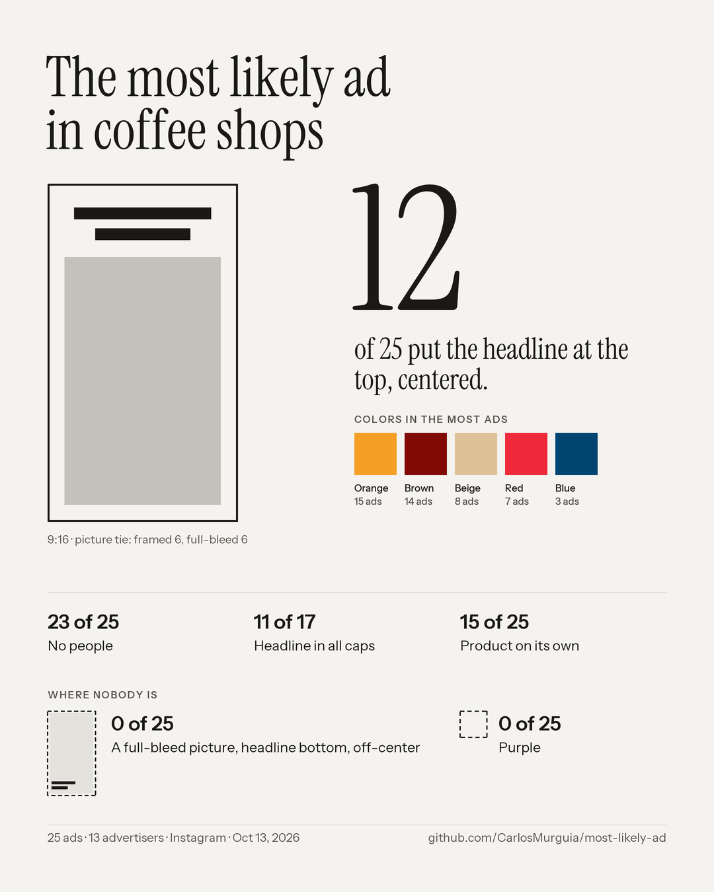

# The most likely ad

A Claude skill that shows you what the ads in your category look like before you make yours, checks how many of those conventions your own ad repeats, and writes a counter-brief so yours doesn't look like them.



Every category has an ad it keeps making: the same picture treatment, the headline in the same place, the same palette, the same typeface. In one study of 246 ads across ten industries, 108 landed in the same two layouts, and in B2B SaaS 17 of 26 ads from 11 competing companies were built the same way. Nobody copied anybody. An ad built that predictably tells the reader what it is before they look inside it, so it often never gets read.

This skill makes that visible for your category, in about 20 minutes.

## Why this exists

Most creative reviews ask whether an ad is good. Almost none ask whether it looks like every other ad in its category, because nobody has the competitors' work laid out side by side when the decision gets made. The layout is usually settled in the first hour, before anyone picks a photo or writes a line, and it's settled the same way everyone else settled it.

The two essays this comes from counted ads one by one, and the pattern held in every industry they looked at. The counting was the slow part. This skill does the counting, so the question "does this look like everyone else?" can be asked in the room, before the layout is approved, not after the campaign underperforms.

It's an open project. The method is written down, the scripts are plain Python, and the rules for coding an ad are in [`structure-taxonomy.md`](skills/most-likely-ad/references/structure-taxonomy.md) so anyone can check them, argue with them, or improve them.

## What it does

1. **Collects** 20–40 recent static ads from your category or from competitors you name, from the public Meta Ad Library or LinkedIn Ad Library.
2. **Codes** each ad on a fixed set of layout decisions: how the picture sits in the frame, where the headline goes, background, typeface style, people, product, promo stickers. It extracts colors with a script, not by eye.
3. **Tallies** the most repeated structures and compares them with chance, and lists the structures, colors and type styles nobody in the sample uses.
4. **Renders a card**: the category's most likely ad as a sketch, its colors and its strongest count, as an image you can share.
5. **Checks your ad** (optional): "Your ad repeats 6 of the category's 7 conventions", with the ones it already breaks.
6. **Writes a counter-brief**: three directions, each breaking one or two conventions on purpose while keeping the ad recognizable as the category.

It measures **sameness, not effectiveness**. Different is not automatically better. It is less predictable.

See a real output: [`examples/coffee-shops-us-2026-10-13.md`](examples/coffee-shops-us-2026-10-13.md) (report) and [`examples/check-my-ad.md`](examples/check-my-ad.md) (check).

## Install

**Claude Code (plugin):**
```bash
/plugin marketplace add CarlosMurguia/most-likely-ad
/plugin install most-likely-ad@most-likely-ad
```

**Claude Code (manual):** copy `skills/most-likely-ad/` into `~/.claude/skills/`.

**Claude.ai / Claude Desktop:** zip the `skills/most-likely-ad/` folder and upload it under Settings → Capabilities → Skills.

**Requirements:** Python 3 and Pillow (`pip install pillow`) for the color script. A browser tool (such as Claude in Chrome) lets Claude read the ad libraries; without one, you can paste screenshots instead.

## Use

Just ask:
> "I'm about to make an Instagram ad for my coffee shop in Austin. What do coffee shop ads look like right now, and how do I make mine different?"

> "Show me the most likely ad for these competitors on LinkedIn: Airtable, Asana, Monday.com, ClickUp, Notion."

> "Here's my new ad [image]. Does it look like everyone else's in my category?"

## A note on the ad libraries

Meta and LinkedIn publish their ad libraries for transparency, but their terms prohibit automated scraping, and there's no API for ordinary US commercial ads. The skill reads the libraries the way a person would: in your own browser, at a human pace, only the handful of ads it needs. If you'd rather, paste screenshots and it works from those.

## Where the method comes from

The taxonomy and the tally come from two essays by Carlos Murguía:
- [You already know what's coming](https://www.carlosmurguia.com/journal/you-already-know-whats-coming): 246 ads, two layout decisions, 108 in the same two structures.
- [The most likely ad](https://www.carlosmurguia.com/journal/ai-and-the-average): four AI image models, one brief, and the ad each one keeps handing back.

## Files
```
skills/most-likely-ad/
  SKILL.md                          workflow Claude follows
  references/structure-taxonomy.md  how to code an ad
  references/ad-libraries.md        how to collect ads, and the traps that bias a sample
  references/counter-brief.md       how to turn the tally into directions
  scripts/palette.py                dominant colors + aspect ratio per image
  scripts/tally.py                  structures, chance comparison, empty cells, one-line summary (+ JSON)
  scripts/compare.py                "Check my ad": conventions your ad repeats
  scripts/card.py                   shareable 1080×1350 card (category, or check)
  assets/fonts/                     open-licensed fonts used by the card
  templates/report.md               report layout
examples/                           sample outputs
data/                               measured categories contributed by users (codes and links, no images)
```

## How you can help

This gets better the more categories it has seen and the more people check its rules. A few ways to pitch in, from five minutes to an afternoon:

- **Run it on your category and share the card.** Post it with a link to this repo. Every card is a small public data point about how a category builds its ads.
- **Contribute a measured category.** If you've run the skill, open a pull request with your `ads.csv` and `manifest.csv` (codes and links only, no images) under `data/<platform>-<category>-<country>-<date>/`. The goal is a shared library of measured categories, so the next person in your industry gets a result in seconds instead of collecting ads from scratch. See [CONTRIBUTING.md](CONTRIBUTING.md).
- **Be a second coder.** Take an existing sample, code the same ads without looking at the first set of codes, and open an issue with where you disagree. Disagreements are how the rules get sharper.
- **Tell us when different worked, or didn't.** This skill can't measure performance. If you ran a counter-brief direction against a conventional version, share what happened in an issue, even if the conventional one won. That's the evidence nobody has.
- **Improve the tools.** Video and carousels, TikTok and Google Display, better color naming, a better card. Issues and pull requests are welcome.
- **Star the repo** if you found it useful. It helps other people find it.

## License
MIT. Use it, change it, ship it. A link back is appreciated.
